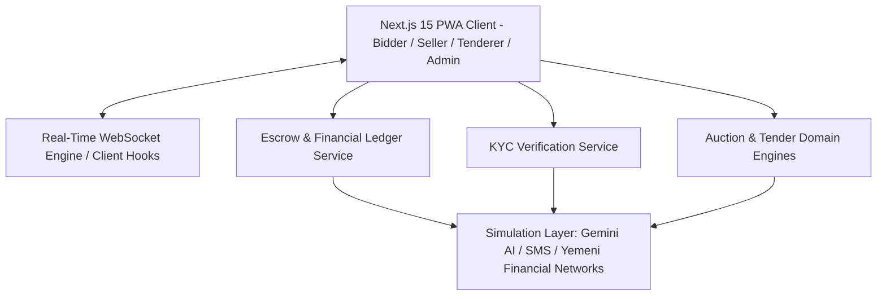

# Project: Mozaid AI (منصة مزايد)
Smart Real-Time Auction, E-Procurement, and Escrow Platform for Yemen

---

## Architecture
Mozaid AI is structured around a resilient, low-latency, modular architecture engineered for the Yemeni market:
- **Presentation Layer (Next.js 15 PWA)**: Server Components and Client Components in `src/app/`, responsive mobile-first Arabic RTL layout, Tailwind CSS, service worker offline caching, and WebP/AVIF compressed assets.
- **Real-Time Bidding Layer (WebSockets)**: Bid broadcast and room management engine in `src/lib/realtime/` or `src/services/auction-room.ts` with sub-150ms synchronized countdown, anti-sniping dynamic candle extensions (+120s up to 20x), connection recovery, and emergency admin controls.
- **Domain & Calculation Engines**: Pure calculation and invariant validation in `src/lib/` (`auction-engine.ts`, `escrow.ts`, `constants.ts`) enforcing zero-leakage commissions (2.5%), reserve price checks, bid increments, and anti-sniping limits.
- **Escrow & Financial Ledger**: 6-stage escrow state machine (`holding -> dispatched -> inspecting -> completed/disputed -> refunded`), 48-hour inspection countdown, auto-release scheduler, and dual Yemeni wallet balances (`available_balance`, `frozen_escrow_balance`).
- **Identity & KYC Subsystem**: Progressive verification tiers (Tier 1 SMS OTP, Tier 2 Yemeni National ID OCR, Tier 3 Selfie match & Trusted Seller badge).
- **External Integration & Simulation Layer (R5)**: Dual-mode services with automatic fallback when environment keys are absent:
  - Gemini AI (`src/lib/gemini.ts`): Multimodal appraisal, RFP drafting, and shill bidding anomaly detection.
  - Yemeni SMS Gateway (`src/services/sms-service.ts`): Carrier-specific validation (77x, 73x, 71x, 70x) and OTP generation/verification.
  - Yemeni Payment & Hawala Network (`src/services/payment-simulation.ts`): Kuraimi Bank, OneCash, Jwali, Floosak, Al-Najm, Al-Omqy voucher and transfer verification.
- **Test Infrastructure**: Vitest test runner with automated unit, integration, and end-to-end acceptance tests.



---

## Feature Inventory
Every feature from the Phase 0 Survey is mapped to its assigned milestone. Every feature has an assigned milestone.

| # | Feature | Description | Milestone | Source |
|---|---------|-------------|-----------|--------|
| 1 | Real-Time Live Bidding Room | Connect to live auction room via WebSocket for live price, timer, and bids | M3 | survey #1 |
| 2 | Quick-Action & Custom Bid Placement | Submit forward bids via quick increment buttons or custom amount | M3 | survey #2 |
| 3 | Anti-Sniping Extension Receiver | Live +120s extension alert and reset when bids placed in final 120s (up to 20x) | M3 | survey #3 |
| 4 | Listing Discovery & Filter Hub | Browse and filter active/upcoming auctions and tenders by category, city, price | M4 | survey #4 |
| 5 | Araboon / Bid Deposit Lock | Freeze required entry deposit in wallet before bidding on high-value assets | M2 | survey #5 |
| 6 | Deposit Refund for Outbid/Losers | Automatically unlock and refund frozen deposit to losers when auction closes | M2 | survey #6 |
| 7 | Escrow Settlement & Payment | Winner funds winning bid into digital escrow via wallet balance | M2 | survey #7 |
| 8 | Inspection Window Countdown (48h) | 48-hour physical inspection countdown starts upon delivery confirmation | M2 | survey #8 |
| 9 | Goods Acceptance & Fund Release | Buyer confirms item matches specs; seller credited net payout (minus 2.5% fee) | M2 | survey #9 |
| 10 | Formal Dispute Filing | Open dispute within 48h inspection window with defect photos and claim | M2 | survey #10 |
| 11 | Digital Arbitration Room Chat | Tripartite chat connecting buyer, seller, and platform dispute officer | M2 | survey #11 |
| 12 | Buy-Now Direct Purchase | Instantly win and close auction by paying preset buy_now_price | M3 | survey #12 |
| 13 | AI Listing Generation (Multimodal) | Multimodal Gemini vision appraisal, Arabic title, specs, and starting price | M1 | survey #13 |
| 14 | Manual Listing Publishing & Setup | Configure starting price, reserve, min increment, deposit, city, duration | M4 | survey #14 |
| 15 | Image Moderation Check | Background AI scan of uploaded listing images to block illegal content | M4 | survey #15 |
| 16 | Real-Time Seller Dashboard | Monitor live bid activity, viewer count, and bidder reputation in real-time | M3 | survey #16 |
| 17 | Dispatch & Delivery Notification | Mark sold item as dispatched (courier or in-person pickup) | M2 | survey #17 |
| 18 | Automated Escrow Auto-Release | Automatically release funds to seller if 48h passes without buyer dispute | M2 | survey #18 |
| 19 | Trusted Seller Badge Acquisition | Verify KYC, >5 successful deals, and >=4.8 rating to earn trusted badge | M2 | survey #19 |
| 20 | AI-Powered RFP / Tender Drafting | Generate formal procurement Markdown RFP from brief requirements | M1 | survey #20 |
| 21 | Reverse Tender Publishing | Publish reverse procurement tender with lots, qualification criteria, budget cap | M4 | survey #21 |
| 22 | Real-Time Reverse Bidding Room | Live procurement room displaying lowest anonymous bid submitted by contractors | M3 | survey #22 |
| 23 | Supplier Compliance Review | Review supplier credentials, past work records, and spec compliance | M4 | survey #23 |
| 24 | Conditional Awarding (الترسية المشروطة) | Formally award tender to optimal supplier balancing price and quality | M4 | survey #24 |
| 25 | Tender Matching & Notifications | AI-driven notification to suppliers matching category and governorate | M4 | survey #25 |
| 26 | Anonymous Reverse Bidding | Submit lower competitive bids meeting decrement rules with supplier anonymity | M3 | survey #26 |
| 27 | Contractor Certification Vault | Upload commercial register, tax cards, and engineering licenses to profile | M4 | survey #27 |
| 28 | Live Multi-Auction Supervision Hub | Admin command grid monitoring all active rooms with real-time tickers | M5 | survey #28 |
| 29 | Emergency Auction Pause & Resume | Admin instant freeze on countdown and incoming bids in suspicious activity | M3 | survey #29 |
| 30 | Erroneous Bid Rollback | Cancel an erroneous bid and restore previous valid highest price | M3 | survey #30 |
| 31 | Manual Time Extension | Admin adds extra duration to compensate for local telecom/power outages | M3 | survey #31 |
| 32 | Bank & Hawala Deposit Queue | Review queue of user deposit slips with transfer ref, name, and receipt photo | M2 | survey #32 |
| 33 | Deposit Approval & Instant Credit | Verify receipt against bank statement and approve deposit with wallet credit | M2 | survey #33 |
| 34 | Deposit Rejection with Reason | Reject forged or invalid slips with custom explanation sent via SMS | M2 | survey #34 |
| 35 | Seller Payout Disbursement | Process manual cash/hawala/bank payouts to sellers upon completed escrow | M2 | survey #35 |
| 36 | Platform Commission Accounting | Real-time accounting ledger tracking cumulative 2.5% fee per currency | M2 | survey #36 |
| 37 | Real-Time Shill Bidding Sentinel | Automated detection of shill bidding rings via IP/device clustering | M1 | survey #37 |
| 38 | Shadow Account Blacklisting & Device Ban | Ban fraudulent users and fingerprint devices, preventing re-registration | M5 | survey #38 |
| 39 | National ID OCR & Data Extraction | Automated extraction of full name, national ID, birth date from Yemeni ID card | M2 | survey #39 |
| 40 | Selfie Liveness & Verification | Compare user selfie against ID portrait photo to compute facial match | M2 | survey #40 |
| 41 | KYC Approval / Rejection Workflow | Admin review workflow granting verified badge or issuing rejection notes | M2 | survey #41 |
| 42 | AI Evidence Difference Analyzer | Multimodal Gemini comparison between original listing and defect photos | M2 | survey #42 |
| 43 | Binding Arbitration Ruling | Issue legally binding dispute resolution (refund, payout, or split) | M2 | survey #43 |
| 44 | Regional & Currency GMV Dashboards | BI charts tracking GMV, deal completion rate, and volume across governorates | M5 | survey #44 |
| 45 | Multi-Currency Digital Wallet | Internal ledger tracking available and frozen balances across YER, USD, SAR | M2 | survey #45 |
| 46 | Yemeni SMS OTP Gateway Integration | Send 6-digit OTP codes via local telecom gateways (77x, 73x, 71x, 70x) | M1 | survey #46 |
| 47 | Offline-First PWA & Asset Optimization | PWA manifest, service worker, WebP/AVIF compression (<500KB bundle) | M4 | survey #47 |
| 48 | Audit Logging & Change Tracking | Comprehensive audit logging of administrative actions, payouts, overrides | M2 | survey #48 |

---

## Milestones

| # | Name | Scope | Dependencies | Status |
|---|------|-------|-------------|--------|
| M1 | Foundation, Simulation Services, & Testing Infra | Root configs (`next.config.ts`, `tailwind.config.ts`, `postcss.config.mjs`, `tsconfig.json`), `package.json` scripts & packages, Vitest runner, `src/types/index.ts` expansion, dual-mode Gemini mock (`src/lib/gemini.ts`), Yemeni SMS gateway simulation (`src/services/sms-service.ts`), Yemeni payment simulation (`src/services/payment-simulation.ts`), foundational unit tests | none | DONE |
| M2 | Escrow, Financial Ledger & KYC Engine | 6-stage Escrow state machine (`src/lib/escrow.ts`, `src/services/escrow-service.ts`), 48h inspection countdown & auto-release, 2.5% platform fee invariant, deposit hold & refund, KYC verification engine (`src/services/kyc-service.ts`), Hawala receipt verification, dispute arbitration logic, unit & integration tests | M1 | DONE |
| M3 | Real-Time Live Bidding Engine & WebSockets | WebSocket room engine (`src/lib/realtime/auction-room.ts`), synchronized server timer, forward auction bidding with +120s anti-sniping extension (up to 20x), reverse tender bidding with supplier anonymity, client hook (`src/hooks/useAuctionRoom.ts`), emergency admin controls (pause, resume, rollback, extend), automated tests | M1 | DONE |
| M4 | Next.js 15 PWA Frontend Portals | PWA assets (`public/manifest.json`, `public/sw.js`), RTL layout (`src/app/layout.tsx`), design system & UI components, Bidder live room page (`/auctions/[id]`), Seller AI creation page (`/auctions/create`), Tenderer AI RFP page (`/tenders/create`), Supplier tender room (`/tenders/[id]/live`), User account & wallet deposit page | M1, M2, M3 | PLANNED |
| M5 | Admin Command Center | Admin layout & routes (`/admin/live`, `/admin/kyc`, `/admin/finance`, `/admin/disputes`, `/admin/ai-security`, `/admin/analytics`), live room supervision, KYC review workflow, deposit voucher review, dispute arbitration console, audit logging views | M2, M3, M4 | PLANNED |
| M6 | Final Milestone: 100% E2E Test Pass & Hardening | Phase 1: Pass 100% of Dual-Track E2E test suite (Tiers 1-4). Phase 2: Tier 5 adversarial coverage hardening. Verification: `npm test` passes, `npm run lint` passes 0 errors, `npm run build` compiles cleanly | M1-M5, TEST_READY.md | PLANNED |

---

## Interface Contracts

### M1 Foundation & Simulation ↔ M2/M3/M4/M5
- **Gemini AI Service (`src/lib/gemini.ts`)**:
  - `generateAuctionSpecs(params: { briefDescription: string; images?: string[] }): Promise<AuctionSpecsResult>`
  - `generateTenderRFP(params: { title: string; rawRequirements: string; category?: string }): Promise<TenderRFPResult>`
  - `analyzeShillBiddingRisk(params: { listingId: string; bids: BiddingTelemetry[]; sellerId: string; sellerIp?: string }): Promise<ShillBiddingAnalysisResult>`
  - Dual-mode behavior: If `process.env.GEMINI_API_KEY` is set and valid, calls GoogleGenAI. Otherwise, transparently returns realistic Yemeni domain Arabic responses. Never throws uncaught network or auth errors.
- **Yemeni SMS Gateway (`src/services/sms-service.ts`)**:
  - `validateYemenPhoneNumber(phone: string): { isValid: boolean; carrier: 'YemenMobile' | 'YOU' | 'Sabafon' | 'Y' | 'Unknown'; normalized: string }`
  - `sendOtp(phone: string): Promise<{ success: boolean; verificationId: string; simulatedCode?: string }>`
  - `verifyOtp(verificationId: string, code: string): Promise<{ success: boolean; error?: string }>`
- **Yemeni Payment Simulation (`src/services/payment-simulation.ts`)**:
  - `submitDepositVoucher(params: { userId: string; channel: PaymentChannel; amount: number; currency: Currency; transferRef: string; receiptUrl: string }): Promise<TransactionRecord>`
  - `verifyDepositVoucher(transactionId: string, adminId: string, approved: boolean, notes?: string): Promise<{ success: boolean; newBalance?: number }>`

### M2 Escrow & KYC ↔ M3/M4/M5
- **Escrow Engine (`src/lib/escrow.ts`, `src/services/escrow-service.ts`)**:
  - `calculateEscrowBreakdown(totalAmount: number): { platformFee: number; sellerPayoutAmount: number }` (fee = 2.5%, rounded to 2 decimals)
  - `createEscrowContract(listingId: string, buyerId: string, sellerId: string, totalAmount: number, currency: Currency): Promise<EscrowContract>`
  - `transitionEscrowStatus(escrowId: string, targetStatus: EscrowStatus, actorId: string, notes?: string): Promise<EscrowContract>`
  - `startInspectionCountdown(escrowId: string, hours?: number): Promise<{ deadline: Date }>` (default: 48h)
  - `evaluateAutoRelease(escrowId: string): Promise<{ released: boolean; reason?: string }>`
  - `fileDispute(escrowId: string, buyerId: string, reason: string, evidenceUrls: string[]): Promise<DisputeRecord>`
  - `settleDispute(disputeId: string, adminId: string, ruling: 'resolved_refund' | 'resolved_payout' | 'resolved_split', splitDetails?: { buyerRefund: number; sellerPayout: number }): Promise<DisputeRecord>`
- **KYC Service (`src/services/kyc-service.ts`)**:
  - `submitNationalIdKyc(userId: string, idData: { nationalIdNumber: string; fullName: string; idFrontUrl: string; idBackUrl: string }): Promise<UserProfile>`
  - `processIdOcr(idFrontUrl: string): Promise<{ ocrConfidence: number; extractedFields: Record<string, string> }>`
  - `verifyLivenessAndSelfie(idPortraitUrl: string, selfieUrl: string): Promise<{ matchConfidence: number; isLivenessVerified: boolean }>`
  - `reviewKycSubmission(userId: string, adminId: string, approved: boolean, rejectionReason?: string): Promise<UserProfile>`

### M3 Real-Time WebSockets ↔ M4/M5
- **Auction Room Engine (`src/lib/realtime/auction-room.ts`)**:
  - `joinRoom(socketId: string, listingId: string, user: { userId: string; role: string; name: string }): RoomState`
  - `leaveRoom(socketId: string): void`
  - `submitBid(listingId: string, bid: { bidderId: string; amount: number; bidderName: string; ipAddress?: string }): BidResult`
    - Validates forward bid via `validateForwardBid` (checks active status, deadline, owner restrictions, increment).
    - Checks anti-sniping: if remaining time <= 120s, extends by +120s up to 20 times (`timesExtended <= 20`).
    - Emits: `NEW_BID`, `AUCTION_EXTENDED`, `TIMER_SYNC`.
  - `submitReverseBid(listingId: string, bid: { supplierId: string; amount: number }): ReverseBidResult`
    - Emits anonymous lowest bid to room without revealing supplier identity.
  - Emergency Admin Commands:
    - `pauseAuction(listingId: string, adminId: string, reason: string): boolean` (emits `AUCTION_PAUSED`)
    - `resumeAuction(listingId: string, adminId: string): boolean` (emits `AUCTION_RESUMED`)
    - `rollbackBid(listingId: string, bidId: string, adminId: string): RollbackResult` (emits `BID_ROLLED_BACK`)
    - `extendAuction(listingId: string, additionalSeconds: number, adminId: string): boolean` (emits `AUCTION_EXTENDED`)

---

## Code Layout

Exclusive file boundaries across milestones:

```
src/
├── app/
│   ├── layout.tsx                     [M4]
│   ├── page.tsx                       [M4]
│   ├── globals.css                    [M1, M4]
│   ├── auctions/
│   │   ├── page.tsx                   [M4]
│   │   ├── [id]/page.tsx              [M4]
│   │   └── create/page.tsx            [M4]
│   ├── tenders/
│   │   ├── page.tsx                   [M4]
│   │   ├── [id]/page.tsx              [M4]
│   │   └── create/page.tsx            [M4]
│   ├── wallet/
│   │   └── page.tsx                   [M4]
│   ├── kyc/
│   │   └── page.tsx                   [M4]
│   └── admin/
│       ├── layout.tsx                 [M5]
│       ├── page.tsx                   [M5]
│       ├── live/page.tsx              [M5]
│       ├── kyc/page.tsx               [M5]
│       ├── finance/page.tsx           [M5]
│       ├── disputes/page.tsx          [M5]
│       └── ai-security/page.tsx       [M5]
├── components/
│   ├── ui/                            [M1, M4]
│   ├── layout/                        [M4]
│   ├── auction/                       [M4]
│   ├── tender/                        [M4]
│   └── admin/                         [M5]
├── hooks/
│   ├── useAuctionRoom.ts              [M3]
│   ├── useRealtimeCountdown.ts        [M3]
│   └── usePwaInstall.ts               [M4]
├── lib/
│   ├── constants.ts                   [M1]
│   ├── auction-engine.ts              [M1, M3]
│   ├── escrow.ts                      [M1, M2]
│   ├── gemini.ts                      [M1]
│   └── realtime/
│       └── auction-room.ts            [M3]
├── services/
│   ├── sms-service.ts                 [M1]
│   ├── payment-simulation.ts          [M1]
│   ├── escrow-service.ts              [M2]
│   └── kyc-service.ts                 [M2]
└── types/
    └── index.ts                       [M1]

public/
├── manifest.json                      [M4]
└── sw.js                              [M4]

tests/ or test suites:
├── unit/                              [M1, M2, M3]
├── integration/                       [M2, M3, M5]
└── e2e/                               [E2E Testing Track]

configs:
├── package.json                       [M1]
├── tsconfig.json                      [M1]
├── next.config.ts                     [M1]
├── tailwind.config.ts                 [M1]
├── postcss.config.mjs                 [M1]
└── vitest.config.ts                   [M1]
```
