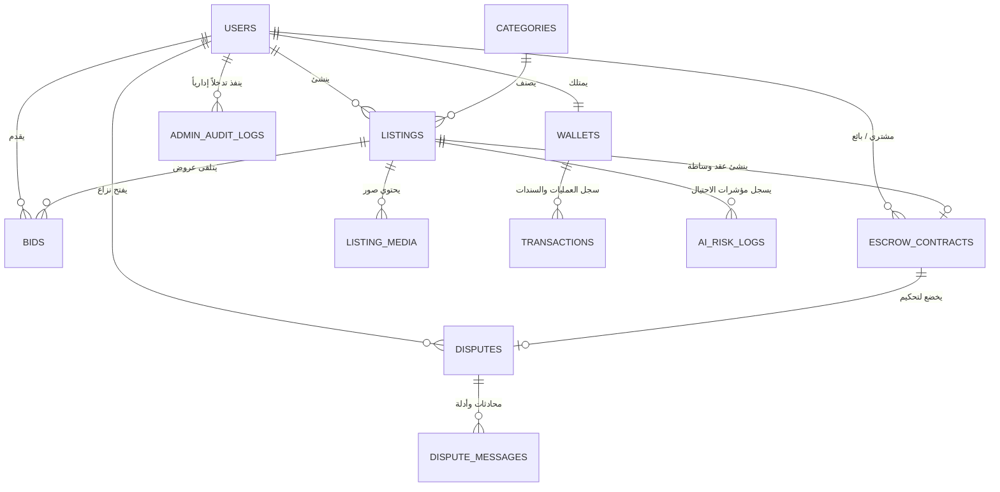

# الدليل التوضيحي لسكيما قاعدة البيانات (Database Architecture & ERD)
# منصة "مزايد" (Mozaid AI)

---

## 1. المخطط العلائقي للكيانات (Entity Relationship Diagram - ERD)

---

## 2. تفصيل الجداول المحورية ووظائفها

### أ. جدول المستخدمين والتوثيق (`users`)
* **الغرض:** حفظ الهوية الرسمية، وحالة التوثيق بالبطاقة الوطنية اليمنية (KYC)، ورقم الهاتف الموثق عبر SMS.
* **الأمان:** تشفير كلمات المرور بحساب تجزئة آمن، وحفظ مسارات وثائق الهوية في حاويات محمية.
* **المؤشرات الحيوية:**
  - `reputation_score`: تقييم الجدية المكتسب من المعاملات الناجحة وخلو السجل من النكول.
  - `is_trusted_seller`: شارة موثوقية تُمنح للبائعين والموردين بعد إثبات الهوية والنشاط التجاري.

### ب. جدول المزادات والمناقصات (`listings`)
* **الغرض:** العمود الفقري لجميع العروض (تصاعدية لبيع السلع أو عكسية لطلبات التوريد والمناقصات).
* **إدارة الوقت ومكافحة القنص (Anti-Sniping):**
  - `anti_sniping_trigger_seconds`: المدة الحرجة (افتراضياً 120 ثانية قبل النهاية).
  - `anti_sniping_extension_seconds`: مدة التمديد التلقائي عند كل مزايدة في الوقت الحرج (120 ثانية).
  - `times_extended`: عدد مرات التمديد لتتبع حماسة المزاد.
* **حقول الذكاء الاصطناعي:**
  - `ai_generated_specs`: كائن JSONB يخزن الجداول الفنية، حالة السلعة، ونقاط التقييم المستخرجة تلقائياً من الصور بواسطة الـ Multimodal AI.

### ج. جدول العطاءات والمزايدات بالوقت الفعلي (`bids`)
* **الغرض:** تسجيل كل عطاء أو زيادة في السعر مع طابع زمني بالميلي ثانية.
* **المقاييس الأمنية لرصد الاحتيال (Anti-Shill Telemetry):**
  - تسجيل `ip_address` و `device_fingerprint`.
  - مؤشر `shill_confidence_score` المحسوب آلياً لمعرفة ما إذا كان المزايد حساباً وهمياً تابعاً لصاحب المزاد.

### د. المحافظ وسندات الصرافة اليمنية (`wallets` & `transactions`)
* **التوافق المحلي مع اليمن:** يدعم جداول الإيداع عبر بنك الكريمي، ون كاش، جوالي، والشبكات النقدية (النجم والعمقي).
* **الفصل المالي الصارم:**
  - `available_balance`: الرصيد المتاح للاستخدام أو السحب.
  - `frozen_escrow_balance`: الرصيد المحجوز كعربون دخول مزاد أو قيمة صفقة تحت المعاينة، مما يمنع السحب المزدوج أو الإفلاس الاحتيالي.

### هـ. عقود الضمان والوساطة المالية (`escrow_contracts`)
* **حماية المشتري:** لا يتم تحويل قيمة الصفقة للبائع إلا بعد انقضاء نافذة المعاينة (`inspection_deadline: 48 ساعة`) وتأكيد المشتري لخلو السلعة من العيوب.
* **حماية المنصة:** الحساب الآلي لعمولة المنصة واقتطاعها فور الإفراج عن المبلغ للبائع.

### و. غرفة النزاعات والتحكيم الرقمي (`disputes` & `dispute_messages`)
* **الغرض:** توفير بيئة قانونية عادلة لفض الخلافات بين البائع والمشتري تحت إشراف محكم إداري معتمد.
* **الدعم الذكي للمحكم:** يستعرض المحكم ملخص `ai_arbitration_summary` الذي يحلل الفروقات بين صور ووصف المزاد الأصلي وبين صور العيوب المرفوعة من المشتري لتقديم قرار منصف وسريع.

---

## 3. خطة الفهارس وتحسين الأداء (Indexing & High-Throughput Strategy)

1. **فهارس المزايدة اللحظية:**
   - فهرس مركب `idx_bids_listing` على `(listing_id, created_at DESC)` لجلب آخر المزايدات لغرفة المزاد في أجزاء من الميلي ثانية.
   - فهرس `idx_bids_amount` على `(listing_id, amount DESC)` للتحقق الفوري من أعلى سعر دون فحص كامل الجدول.
2. **فهارس محرك الإغلاق والجدولة:**
   - فهرس `idx_listings_ends_at` لتمكين مهام الخلفية (Background Workers) من رصد المزادات المنتهية في كل ثانية ومعالجتها بدون تأخير.
3. **فهارس البحث والفلترة:**
   - دعم البحث النصي الكامل (Full-Text Search) على عنوان ووصف المزاد والمناقصة باللغة العربية.
