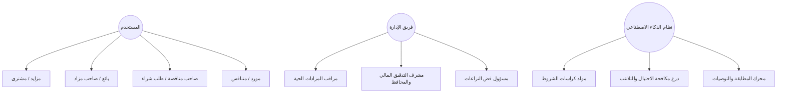
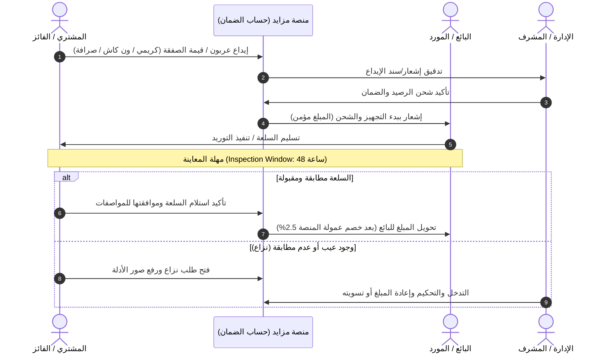

# وثيقة متطلبات المنتج (PRD)
# منصة "مزايد" (Mozaid AI) - منصة المزادات والمناقصات الذكية

---

## 1. الملخص التنفيذي ورؤية المنصة (Executive Summary & Vision)

### 1.1 الرؤية
بناء منصة وطنية وإقليمية رائدة تجمع بين **المزادات التصاعدية للسلع والأصول (Forward Auctions)** و**المناقصات التنافسية العكسية (Reverse Auctions & Tenders)**، مدعومة بتقنيات **الذكاء الاصطناعي (AI)** لتقييم وتسريع الصفقات، ومصممة خصيصاً للعمل بكفاءة وموثوقية في بيئة السوق اليمني، لربط الأفراد والشركات في بيئة تجارية شفافة وعادلة تحمي حقوق جميع الأطراف.

### 1.2 الأهداف الاستراتيجية
1. **تمكين الصفقات العادلة والسريعة:** إتاحة بيع الأصول والسلع (عقارات، مركبات، بضائع، إلكترونيات) بأعلى سعر حقيقي في السوق عبر مزادات بالوقت الفعلي.
2. **خفض تكاليف الشراء والمشتريات:** تمكين الأفراد والشركات من طرح طلبات الشراء والمشاريع وتلقي عروض توريد تنافسية بأفضل جودة وأنسب سعر.
3. **أتمتة العمليات بالذكاء الاصطناعي:** مساعدة المستخدمين في كتابة مواصفات المزادات وكراسات الشروط، توجيه الفرص للأطراف المناسبة، وكشف التلاعب والمزايدات الوهمية آلياً.
4. **حل معضلة الثقة والمدفوعات في اليمن:** سد فجوة غياب بوابات الدفع الدولية عبر توفير نظام وساطة وضمان مالي محلي (Escrow) مرتبط بالمحافظ وشبكات الصرافة اليمنية المعتمدة (الكريمي، ون كاش، جوالي، النجم، العمقي).

---

## 2. دراسة السوق اليمني والحلول المتوافقة (Yemeni Context & Localization)

| التحدي في السوق اليمني | الحل المعتمد في منصة مزايد |
| :--- | :--- |
| **غياب البطاقات الائتمانية العالمية وبوابات الدفع التقليدية** | توفير نظام **المحفظة الرقمية وسندات الإيداع المحلية** (حسابات بنك الكريمي، ون كاش، جوالي، كاش، شبكات النجم والعمقي) مع دورة اعتماد وتدقيق سريعة من لوحة الإدارة. |
| **ضعف وتذبذب سرعات الإنترنت** | بناء واجهة **PWA (تطبيق ويب تقدمي)** خفيفة الحجم تعتمد تقنيات التخزين المؤقت وضغط الصور وتحديثات البيانات الدقيقة عبر WebSockets دون تحميل الصفحات بالكامل. |
| **المزايدات الكاذبة وانعدام الالتزام** | تطبيق نظام **توثيق الهوية (KYC)** بالبطاقة الشخصية اليمنية/الرقم الوطني ورقم الهاتف الموثق عبر SMS، مع تجميد مبلغ تأمين (عربون) لدخول المزادات الكبرى. |
| **مخاوف المشتري من الاحتيال أو رداءة السلعة** | نظام **الوساطة الضامنة (Escrow)**: لا يُسلّم المبلغ للبائع إلا بعد فحص ومعاينة المشتري للسلعة وموافقته عليها خلال نافذة المعاينة (Inspection Window). |

---

## 3. أدوار المستخدمين وصلاحياتهم (User Roles & Personas)



### 3.1 المزايد / المشتري (Buyer / Bidder)
* تصفح المزادات والمناقصات حسب التصنيف، المدينة، والنطاق السعري.
* المزايدة اللحظية بالوقت الفعلي في غرف المزايدة.
* متابعة حالة الصفقات، دفع العربون، واستلام وتأكيد السلع.
* فتح طلب نزاع في حال عدم مطابقة السلعة أو الخدمة للمواصفات.

### 3.2 البائع / صاحب المزاد (Seller / Auctioneer)
* إنشاء مزاد تصاعدي بخطوات بسيطة بمساعدة الذكاء الاصطناعي (وصف، صور، سعر افتتاحي، حد أدنى للمزايدة، وقت الإغلاق).
* متابعة المزايدات الحية وإشعار الفائز تلقائياً.
* شحن أو تسليم السلعة واستلام المستحقات المالية في حسابه/محفظته بعد موافقة المشتري.

### 3.3 صاحب المناقصة / المشتري للشركات والأفراد (Tender Issuer)
* طرح مناقصة / طلب توريد أو تنفيذ مشروع بمواصفات وشروط واضحة مولدة بالذكاء الاصطناعي.
* تحديد نوع المزايدة العكسية (تنافس بالوقت الفعلي مع إظهار أقل سعر).
* استعراض العروض، تقييم ملفات الموردين، وترسية المناقصة.

### 3.4 المورد / المقاول (Supplier / Contractor)
* تلقي تنبيهات وترشيحات ذكية للمناقصات التي تطابق نشاطه وتخصصه.
* تقديم عروض الأسعار والتنافس بالوقت الفعلي لتقديم السعر الأفضل.
* إرفاق الشهادات وسابقة الأعمال وضمانات التنفيذ.

### 3.5 الإدارة والمشرفون (Admin & Operations)
* مراقبة المزادات الحية والتدخل في حالات الطوارئ.
* التحقق من سندات الإيداع وتأكيد شحن أرصدة المحافظ وتسوية العمولات.
* مراجعة وثائق التحقق من الهوية (KYC).
* إدارة التحكيم وفض النزاعات وإصدار قرارات الصرف أو الاسترداد.

---

## 4. آليات ونماذج العمل الأساسية للمنصة (Core Business Engines)

### 4.1 المزادات التصاعدية الحية (Forward Auctions)
* **نوع التنافس:** تصاعدي (أعلى سعر هو الفائز).
* **التحديث اللحظي:** يعتمد على WebSockets لتحديث السعر واسم المزايد في أجزاء من الثانية لدى جميع المتواجدين في غرفة المزاد.
* **تمديد الوقت التلقائي (Anti-Sniping Logic):**
  - إذا تم تقديم مزايدة خلال آخر دقيقتين من وقت انتهاء المزاد، يتم تمديد العداد تلقائياً لمدة دقيقتين إضافيتين لإعطاء فرصة عادلة للجميع ومنع القرصنة في الثواني الأخيرة.
* **الحد الأدنى للزيادة (Bid Increment):** يُحسب تلقائياً حسب قيمة السلعة (مثال: 5,000 ريال للسلع الصغيرة، 50,000 ريال للسيارات والعقارات).

### 4.2 المناقصات والمزايدات العكسية (Reverse Real-Time Tenders)
* **نوع التنافس:** تناقصي/عكسي (أقل سعر مع مطابقة المواصفات هو الفائز).
* **الشفافية اللحظية:** تظهر أسعار العروض التنافسية لحظياً للجميع بشكل مفتوح طوال فترة فتح المناقصة، مما يحفز الموردين على تقديم أفضل أسعارهم.
* **الترسية المشروطة:** يملك صاحب المناقصة حق مراجعة جودة العرض الفائز قبل الترسية النهائية لضمان عدم التنازل عن المواصفات مقابل السعر فقط.

---

## 5. ميزات ووظائف الذكاء الاصطناعي (AI Capabilities Specification)

```
+-----------------------------------------------------------------------------------+
|                           طبقة الذكاء الاصطناعي للمنصة                           |
+-----------------------------------------------------------------------------------+
|  1. توليد المواصفات     |  2. المطابقة الذكية            |  3. درع مكافحة الاحتيال |
|  (Auto-Spec Generator) |  (Smart Recommendation Engine) |  (Anti-Shill & Fraud)   |
|  - تحليل صور السلع      |  - تحليل تصنيف وسجل الموردين    |  - كشف الحسابات المشبوهة |
|  - صياغة الشروط قانونياً |  - إرسال تنبيهات واتساب/SMS     |  - تتبع تقارب عناوين IP  |
|  - اقتراح السعر المبدئي|  - مطابقة الكلمات المفتاحية     |  - تنبيه رفع السعر المصطنع|
+-----------------------------------------------------------------------------------+
```

### 5.1 التوليد الآلي لكراسات الشروط ووصف المزادات (Auto-Specification & RFP Generator)
* يقوم البائع/المشتري بكتابة سطر واحد أو رفع صورة للسلعة/المشروع.
* يقوم محرك الذكاء الاصطناعي (Gemini Vision & Multimodal) بتحليل الصورة واستخراج:
  - الاسم الدقيق للمنتج وموديله.
  - جدول المواصفات الفنية المعتادة.
  - قائمة الشروط والضمانات الواجب توفرها (شروط التسليم، الفحص، الإرجاع).
* توفير الوقت على المستخدم وضمان إدراج كافة التفاصيل التي تحميه قانونياً.

### 5.2 محرك التوصيات والمطابقة الذكية (Smart Matching Engine)
* عند نشر مناقصة أو مزاد جديد، يقوم النظام بمطابقة بنود الطلب مع قاعدة بيانات الموردين والمشترين المهتمين.
* إرسال تنبيهات فورية مستهدفة عبر الرسائل القصيرة (SMS) أو الإشعارات اللحظية للموردين الأكثر ملاءمة وسجلهم ممتاز في نفس المجال والمدينة.

### 5.3 نظام كشف المزايدات الوهمية والاحتيال (Anti-Shill Bidding & Anomaly Shield)
* مراقبة سلوك المزايدين في الوقت الفعلي:
  - تنبيه المشرفين إذا كان المزايد يدخل من نفس شبكة أو IP صاحب المزاد.
  - رصد حسابات "الظل" التي ترفع السعر فقط ثم تنسحب عند اقتراب النهاية.
  - تجميد المزايدات المشبوهة تلقائياً وعرضها في لوحة المشرفين للتدقيق الفوري.

---

## 6. نظام الضمان المالي والوساطة (Escrow & Trust Architecture)



---

## 7. لوحة تحكم الإدارة الشاملة (Admin Command Center)

تتألف لوحة الإدارة من 5 مراكز تشغيل متقدمة:

### 7.1 غرفة المراقبة اللحظية للمزادات (Live Command Center)
* شاشة متزامنة تعرض كافة المزادات والمناقصات المفتوحة في لحظتها.
* أزرار الطوارئ الفورية:
  - زر إيقاف مؤقت للمزاد (Pause Auction).
  - زر إلغاء مزايدة وهمية والتراجع لآخر سعر صحيح.
  - زر تمديد وقت المزاد يدوياً.

### 7.2 مركز التدقيق المالي والمحافظ (Financial & Escrow Management)
* طابور تدقيق سندات الإيداع المرفوعة من المستخدمين مع إظهار رقم العملية واسم المودع.
* تأكيد الإيداع بضغطة زر ليشحن رصيد محفظة المستخدم فوراً.
* تقرير العمولات المستحقة للمنصة وسجل التحويلات المنفذة للبائعين.

### 7.3 مركز الذكاء الاصطناعي ومكافحة الاحتيال (AI Security Center)
* لوحة تنبيهات المخاطر (Fraud Alerts):
  - مؤشر الشك في المزايدات (Shill Index).
  - الحسابات المتكررة على نفس الجهاز أو الشبكة.
  - فحص محتوى المزادات التلقائي لمنع البضائع المحظورة.

### 7.4 إدارة المستخدمين وتوثيق الهويات (User KYC & Trust Hub)
* تدقيق بطاقات الهوية الشخصية وجوازات السفر.
* منح شارة "بائع موثوق" أو "مورد معتمد" بعد إتمام المعايير.
* تجميد أو حظر المستخدمين المخالفين مع ذكر سبب الحظر وسجل النشاط.

### 7.5 تقارير الأداء ومؤشرات الأعمال (BI & Analytics)
* إجمالي حجم التداولات بالريال اليمني والدولار (GMV).
* نسبة إتمام المزادات والمناقصات بنجاح.
* أوقات الذروة والمناطق الجغرافية الأكثر نشاطاً (صنعاء، عدن، تعز، حضرموت، إلخ).

---

## 8. نظام إدارة النزاعات والتحكيم (Dispute Resolution Engine)

1. **غرفة التحكيم الرقمية:** مساحة تجمع المشتري والبائع والمشرف، مع سجل كامل لكل ما تم في غرفة المزاد، والرسائل المتبادلة، وتفاصيل الكراسة الأصلية.
2. **التحليل الذكي للمطابقة:** يستعرض الـ AI صور السلعة عند التسليم مقارنة بصور وكراسة المزاد الأصلية، ويقدم تقرير نسبة التطابق للمشرف.
3. **القرارات الإدارية الملزمة:**
   - **الاسترداد الكامل للمشتري:** في حال عدم التسليم أو ثبوت عيب جوهري مخفي.
   - **الصرف الكامل للبائع:** في حال رفض المشتري الاستلام دون سبب مشروع أو بعد انقضاء مهلة المعاينة.
   - **التسوية الجزئية:** الاتفاق على خصم نسبة معينة تعويضاً عن نقص طفيف في المواصفات.
   - **مصادرة العربون:** تغريم الطرف الناكل عن الصفقة وحظر حسابه مؤقتاً أو نهائياً.

---

## 9. المتطلبات غير الوظيفية (Non-Functional Requirements)

1. **الأداء وسرعة الاستجابة:** زمن استجابة تسجيل العرض الجديد في غرفة المزايدة < **150 مللي ثانية**.
2. **كفاءة استهلاك البيانات:** حجم الصفحة الأولى لا يتجاوز **500 كيلوبايت**، مع تفعيل ضغط صور WebP/AVIF لتلائم شبكات الجيل الثالث والرابع في اليمن.
3. **التوفرية والموثوقية (Availability):** 99.9% uptime مع تفعيل Redis Caching لقوائم المزادات المفتوحة.
4. **الأمان وحماية البيانات:**
   - تشفير كلمات المرور والبيانات الحساسة بتقنيات Argon2 / Bcrypt.
   - حماية مسارات الـ API بمعدل طلبات محدد (Rate Limiting) لمنع هجمات الـ DDoS وروبوتات المزايدة العشوائية.
   - عزل وثائق الهوية والـ KYC في حاويات تخزين مشفرة لا تتاح إلا للمشرفين المعتمدين.
